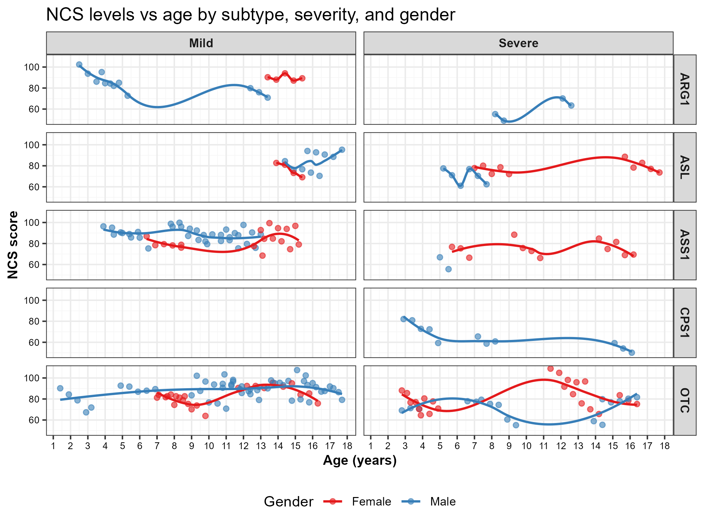

**This document performs Part 1 - Part 5 of the take-home assignment.**  

---

# **PART 1 - Data Exploration and Quality Control**

## Setup

```{r setup, warning=FALSE}
library(tidyverse)
library(readr)
library(data.table)
library(dplyr)
library(ggplot2)
library(tidyr)
library(naniar)
library(UpSetR)
library(ggfortify)
library(edgeR)
library(limma)
library(ComplexHeatmap)
library(circlize)
```

## Load Data

I began this analysis by loading the five available datasets (clinical, metabolomics, radiomics, RNA-seq counts, and RNA-seq metadata) and inspecting basic dimensions, column names, and identifiers. At this stage, my goal was simply to understand what constitutes a 'sample' in each modality.

```{r Load-Data, warning=FALSE}
clinical   <- read.csv("data/clinical.csv")
radiomics  <- read.csv("data/radiomics.csv")
metabol    <- read.csv("data/metabolomics.csv")
rnameta    <- read_delim("data/rnaseq_metadata.tsv", delim = ",")
rnacounts_raw <- fread("data/rnaseq_counts.tsv", data.table = FALSE)

# Create directory "part1"
if (!dir.exists("part1")) 
  dir.create("part1")
```

## RNAseq Preprocessing

My first attempt to load the count matrix with gene identifiers as row names failed due to duplicated row names. 

```{r RNAseq-Prep, warning=FALSE}
colnames(rnacounts_raw)[1] <- "genes"

rnacounts_raw <- rnacounts_raw %>%
  filter(!is.na(genes), genes != "")

rnacounts_raw$genes <- make.unique(rnacounts_raw$genes)

rownames(rnacounts_raw) <- rnacounts_raw$genes
rnacounts <- rnacounts_raw[, -1, drop = FALSE]
rnacounts[] <- lapply(rnacounts, as.numeric)
rnacounts <- as.matrix(rnacounts)
mode(rnacounts) <- "numeric"

rm(rnacounts_raw)
```

## Clinical Overview

I next focused on describing the cohort using the clinical dataset, since it defines patient-level structure. I computed the number of unique patients and visits and produced a bar plot of the number of visits per patient. I initially assumed visit completeness would be roughly uniform, but the plot revealed substantial imbalance.

### Number of Visits per Patient
```{r Visits-Patient, warning=FALSE}
clinical %>%
  summarise(
    n_patients = n_distinct(patient_id),
    n_samples  = n_distinct(sample_id),
    max_visits = max(visit)
  )

clinical %>%
  count(patient_id, name = "num_patients") %>%
  count(num_patients, name = "num_visits")

p <-clinical %>%
  count(patient_id, name = "num_patients") %>%
  count(num_patients,name = "num_visits") %>%
  ggplot(aes(x = num_patients, y = num_visits, fill = factor(num_patients))) +
  geom_bar(position="stack", 
           stat="identity",
           colour = "black",     
           linewidth = 0.05) +
  xlab("Number of visits per patient") +
  ylab("Patient count") +
  guides(fill = "none") + 
  scale_fill_brewer(palette = "Set3") +
  theme_classic() +
  theme(
    panel.grid.minor = element_line(color = "gray97"),
    axis.title.y = element_text(size = 10, color = "black", face = "bold"),
    axis.title.x = element_text(size = 10, color = "black", face = "bold"),
    axis.text.y = element_text(size = 9, color = "black"), 
    axis.text.x = element_text(size = 9, color = "black"), 
    legend.position = "none"  )

p

ggsave("part1/clinical_patients_visit.png", p, height=2.8, width=4, dpi=300)
```

**Interpretation:** The plot reveals that the majority of patients contributed all five visits (over 30 patients), with progressively fewer patients at lower visit counts and only 2–3 patients contributing a single visit. This imbalance toward more complete follow-up indicates that attrition is modest but that the dataset is not uniformly longitudinal. Analyses assuming balanced repeated measures should account for this sparsity, and the overrepresentation of fully observed patients may introduce selection bias if completeness correlates with disease trajectory.

### Block 1: Clinical Severity Markers

I also examined age, gender, subtype, and severity distributions, stratifying age by subtype and severity.  

#### Age Distributions by Subtype, Severity, and Gender
```{r Age-Distribution, warning=FALSE}

clinical$sex <- factor(clinical$sex, levels = c("F", "M"))

p <-ggplot(clinical, aes(x = age, fill = sex)) +
  geom_histogram(
    bins = 30,
    alpha = 0.8,
    position = "identity"
  ) +
  facet_grid(subtype ~ severity,
             labeller = labeller(
             severity = c(mild = "Mild", severe = "Severe"))) +
  scale_fill_manual(
    values = c(F = "#E41A1C", M = "#377EB8"),
    labels = c(F = "Female", M = "Male")
  ) +
  scale_x_continuous(breaks = seq(1, 18, by = 1)) +
  labs(
    title = "Age distributions by subtype and severity, stratified by gender",
    x = "Age (years)",
    y = "Sample counts",
    fill = "Gender"
  ) +
  theme_bw() +
  theme(
      panel.grid.minor = element_line(color = "gray97"),
      axis.title.y = element_text(size = 10, color = "black", face = "bold"),
      axis.title.x = element_text(size = 10, color = "black", face = "bold"),
      axis.text.y = element_text(size = 7, color = "black"), 
      axis.text.x = element_text(size = 7, color = "black"), 
      strip.text = element_text(size = 9, face = "bold"),
      legend.position = "bottom")

p

ggsave("part1/severity_vs.gender_age.png", p, height=5.4, width=6.8, dpi=300)

```

**Interpretation:** The faceted histograms demonstrate substantial heterogeneity in age distributions across subtypes and severity levels. Some subtypes such as OTC display broader age ranges, while others like ARG1 are concentrated in narrower bands. Gender representation varies by subtype, and the mild versus severe panels reveal that certain subtypes have age distributions shifted toward younger or older ages depending on severity. This demographic unevenness must be considered when interpreting any subtype-level comparative analyses, as confounding by age and gender is plausible.

#### Ammonia vs. age

I initially attempted to visualize all clinical variables in a single plot, but this quickly became unreadable. I revised this approach by splitting the analysis into age-dependent trajectories (age vs ammonia and age vs NCS) and severity-stratified summaries (boxplots of ammonia, NCS, and number of hyperammonemic events). Log-scaling ammonia was not an initial decision; I tried a linear scale first and found that extreme values obscured structure among the bulk of observations. Switching to a log scale revealed subtype- and severity-specific patterns that were otherwise hidden. Throughout this process, I reminded myself that these plots are descriptive and do not adjust for repeated measures, a limitation I explicitly note.

```{r Ammonia, warning=FALSE}
p <- ggplot(clinical, aes(x = age, y = ammonia, color = sex)) +
  geom_point(alpha = 0.6, size = 1.6) +
  geom_smooth(
    method = "lm",
    se = FALSE,
    linewidth = 0.8
  ) +
  facet_grid(
    subtype ~ severity,
    labeller = labeller(severity = c(mild = "Mild", severe = "Severe"))
  ) +
  scale_color_manual(
    values = c(F = "#E41A1C", M = "#377EB8"),
    labels = c(F = "Female", M = "Male")
  ) +
  scale_y_log10(labels = scales::comma) +
  scale_y_continuous(breaks = seq(0, 400, by = 100)) +
  scale_x_continuous(breaks = seq(1, 18, by = 1)) +
  labs(
    title = "Ammonia levels vs age by subtype, severity, and gender",
    x = "Age (years)",
    y = "Ammonia (log scale)",
    color = "Gender"
  ) +
  theme_bw() +
  theme(
    panel.grid.minor = element_line(color = "gray97"),
    axis.title.y = element_text(size = 10, color = "black", face = "bold"),
    axis.title.x = element_text(size = 10, color = "black", face = "bold"),
    axis.text.y = element_text(size = 7, color = "black"), 
    axis.text.x = element_text(size = 7, color = "black"), 
    strip.text = element_text(size = 9, face = "bold"),
    legend.position = "bottom")

p

ggsave("part1/ammonia_severity_vs.gender_age.png", p, height=5.4, width=7.2, dpi=300)
```

**Interpretation:** Ammonia levels on the log scale show subtype- and severity-specific trajectories across age. In several subtypes, severe cases exhibit higher and more variable ammonia levels compared to mild cases. Trend lines reveal divergent patterns between genders in some panels, particularly for OTC and ASS1. The log scale was essential for resolving these patterns: extreme values in severe cases would otherwise compress mild-range variation, obscuring biologically meaningful structure among the majority of observations.

#### NCS vs. age

```{r NCS, warning=FALSE}
p <- ggplot(clinical, aes(x = age, y = ncs, color = sex)) +
  geom_point(alpha = 0.6, size = 1.6) +
  geom_smooth(
    method = "loess",
    se = FALSE,
    linewidth = 0.8
  ) +
  facet_grid(
    subtype ~ severity,
    labeller = labeller(severity = c(mild = "Mild", severe = "Severe"))
  ) +
  scale_color_manual(
    values = c(F = "#E41A1C", M = "#377EB8"),
    labels = c(F = "Female", M = "Male")
  ) +  scale_x_continuous(breaks = seq(1, 18, by = 1)) +
  labs(
    title = "NCS levels vs age by subtype, severity, and gender",
    x = "Age (years)",
    y = "NCS score",
    color = "Gender"
  ) +
  theme_bw() +
  theme(
    panel.grid.minor = element_line(color = "gray97"),
    axis.title.y = element_text(size = 10, color = "black", face = "bold"),
    axis.title.x = element_text(size = 10, color = "black", face = "bold"),
    axis.text.y = element_text(size = 7, color = "black"), 
    axis.text.x = element_text(size = 7, color = "black"), 
    strip.text = element_text(size = 9, face = "bold"),
    legend.position = "bottom")

p

ggsave("part1/ncs_severity_vs.gender_age.png", p, height=5.4, width=7.2, dpi=300)
```

**Interpretation:** NCS scores generally range between 60 and 100, with most values clustering at the higher end. Trend lines indicate that NCS tends to remain stable or increase slightly with age in mild cases, whereas severe cases show more variable and sometimes declining trajectories. Gender-specific differences are apparent in certain subtypes such as OTC, where male and female trend lines diverge. The narrow range of NCS in mild cases contrasts with the wider dispersion in severe cases, consistent with greater clinical heterogeneity in the severe group.

### Block 2: Event Burden and Interventions

#### Hyperammonemic Events (HAE)
```{r Hae, warning=FALSE}
p <-ggplot(clinical, aes(subtype, n_hae, fill = sex)) +
  geom_boxplot(outlier.alpha = 0.4) +
  facet_wrap(
    ~ severity,
    labeller = labeller(severity = c(mild = "Mild", severe = "Severe"))
  ) +
  scale_fill_manual(
    values = c(F = "#E41A1C", M = "#377EB8"),
    labels = c(F = "Female", M = "Male")
  ) +
  theme_bw() +
  labs(
    title = "Number of hyperammonemic events by subtype, severity, and gender",
    x = "Subtype",
    y = "Number of HAE events"
  ) +
  theme(
    panel.grid.minor = element_line(color = "gray97"),
    axis.title.y = element_text(size = 10, color = "black", face = "bold"),
    axis.title.x = element_text(size = 10, color = "black", face = "bold"),
    axis.text.y = element_text(size = 7, color = "black"), 
    axis.text.x = element_text(size = 7, color = "black"), 
    strip.text = element_text(size = 10, face = "bold"),
    legend.position = "right")

p 

ggsave("part1/hae_severity_vs.gender.png", p, height=4, width=6.8, dpi=300)
```

**Interpretation:** : The boxplots confirm that severe cases generally experience more HAE events, with notable outliers in subtypes like OTC and ASS1. In mild cases, HAE counts are low and relatively homogeneous across subtypes. Gender-based differences are modest in most subtypes, though select panels show differential patterns. The presence of high outliers in the severe group highlights that a subset of patients carries disproportionate clinical burden, which may influence group-level summary statistics.

#### Transplant Events
```{r Transplant, warning=FALSE}
p <- ggplot(clinical, aes(subtype, fill = sex, weight = transplant)) +
  geom_bar(position = "dodge",
           colour = "black",     
           linewidth = 0.05) +
  facet_wrap(
    ~ severity,
    labeller = labeller(severity = c(mild = "Mild", severe = "Severe"))
  ) +
  scale_fill_manual(
    values = c(F = "#E41A1C", M = "#377EB8"),
    labels = c(F = "Female", M = "Male")
  ) +
  theme_bw() +
  labs(
    title = "Number of transplant events by subtype, severity, and gender",
    x = "Subtype",
    y = "Number of patients that had one transplant",
    fill = "Gender"
  ) +
  theme(
    panel.grid.minor = element_line(color = "gray97"),
    axis.title.y = element_text(size = 10, color = "black", face = "bold"),
    axis.title.x = element_text(size = 10, color = "black", face = "bold"),
    axis.text.y = element_text(size = 7, color = "black"),
    axis.text.x = element_text(size = 7, color = "black"),
    strip.text = element_text(size = 10, face = "bold"),
    legend.position = "right")

p 

ggsave("part1/transplant_severity_vs.gender.png", p, height=4, width=6.8, dpi=300)
```

**Interpretation:** Transplant events are concentrated in specific subtype-severity-gender combinations. In mild cases, ASS1 and OTC have the highest transplant counts with evident sex-based differences (more females in ASS1 mild, more males in OTC mild). In severe cases, OTC dominates transplant events with roughly equal representation between genders. ARG1 and CPS1 have minimal or no transplant events. This pattern suggests that transplant decisions are highly subtype-dependent and may also reflect severity-specific clinical trajectories and referral practices.

### Block 3: Integrated Clinical Burden

```{r Integrated-Burden, warning=FALSE}
clinical_long <- clinical %>%
  select(severity, subtype, sex, ammonia, ncs, n_hae) %>%
  pivot_longer(cols = c(ammonia, ncs, n_hae), names_to="measure", values_to="value")

p <- ggplot(clinical_long,
       aes(x = severity, y = value, fill = sex)) +
  geom_boxplot(
    position = position_dodge(width = 0.8),
    outlier.alpha = 0.4
  ) +
  geom_jitter(
    position = position_dodge(width = 0.8),
    alpha = 0.3,
    size = 0.8
  ) +
  facet_grid(
    measure ~ subtype,
    scales = "free_y"
  ) +
  scale_fill_manual(
    values = c(F = "#E41A1C", M = "#377EB8"),
    labels = c(F = "Female", M = "Male")
  ) +
  scale_x_discrete(labels = c(mild = "Mild", severe = "Severe")) +
  labs(
    title = "Clinical burden measures by severity, subtype, and gender",
    x = "Severity",
    y = "Value",
    fill = "Gender"
  ) +
  theme_bw() +
  theme( 
    panel.grid.minor = element_line(color = "gray97"),
    axis.title.y = element_text(size = 10, color = "black", face = "bold"),
    axis.title.x = element_text(size = 10, color = "black", face = "bold"),
    axis.text.y = element_text(size = 7, color = "black"), 
    axis.text.x = element_text(size = 7, color = "black"), 
    strip.text = element_text(size = 10, face = "bold"),
    legend.position = "bottom")

p

ggsave("part1/clinical_integrated.png", p, height=4, width=6.8, dpi=300)
```

**Interpretation:** The boxplots of ammonia, number of HAE events (n_hae), and NCS stratified by severity, subtype, and gender confirm that severe cases consistently have higher ammonia levels and more HAE events across most subtypes, while NCS values tend to be lower. Gender-based differences are visible but variable: some subtype panels show near-parity between males and females, while others exhibit clear separation. Individual data points reveal notable outliers, particularly in ammonia and HAE counts for severe patients, underscoring the skewed distribution of clinical burden.

### Block 4: Multimodal QC Heatmap Interpretation

```{r Integrated-MR, warning=FALSE}
dat <- clinical %>%
  dplyr::select(patient_id, visit, age, sex, subtype, severity) %>%
  left_join(radiomics,  by = c("patient_id", "visit")) %>%
  left_join(metabol,   by = c("patient_id", "visit"))

dat$sample_id.y <- NULL
colnames(dat)[7] <- "sample_id"

dat <- dat %>%
  mutate(age_bin = cut(age, breaks = c(0,5,10,15,20), include.lowest = TRUE))

num_cols <- dat %>%
  dplyr::select(-patient_id, -sample_id, -visit, -subtype, -severity, -sex, -age, -age_bin, -batch) %>%
  dplyr::select(where(is.numeric)) %>%
  colnames()

metabolomics_vars_raw <- colnames(metabol)[!(colnames(metabol) %in% c("patient_id","visit","batch"))]
radiomics_vars_raw <- colnames(radiomics)[!(colnames(radiomics) %in% c("patient_id","visit"))]

metabolomics_z <- paste0("z_", metabolomics_vars_raw)
radiomics_z <- paste0("z_", radiomics_vars_raw)

dat_z <- dat %>%
  group_by(subtype, severity, age_bin) %>%
  mutate(across(all_of(num_cols), ~ scale(.)[,1], .names = "z_{col}"))

dat_z <- dat_z %>%
  mutate(
    sex = recode(sex,
                 "F" = "Female",
                 "M" = "Male"),
    severity = recode(severity,
                      "mild" = "Mild",
                      "severe" = "Severe"),
    sex = factor(sex, levels = c("Female", "Male")),
    severity = factor(severity, levels = c("Mild", "Severe")),
    subtype = factor(subtype, levels = c("ARG1", "ASL", "ASS1", "CPS1", "OTC"))
  )

dat_z <- dat_z[order(dat_z$sex, dat_z$severity),]

z_cols <- grep("^z_", colnames(dat_z), value = TRUE)

top_deviation <- dat_z %>%
  rowwise() %>%
  mutate(
    # store the vector of z-scores as a list
    z_vals = list(c_across(all_of(z_cols))),
    
    # compute max deviation safely
    max_dev = if (all(is.na(z_vals[[1]]))) NA_real_
    else max(abs(z_vals[[1]]), na.rm = TRUE),
    
    # compute feature name safely
    max_feature = if (all(is.na(z_vals[[1]]))) NA_character_
    else z_cols[which.max(abs(z_vals[[1]]))]
  ) %>%
  ungroup() %>%
  dplyr::select(-z_vals)

top_deviation %>%
  group_by(patient_id, max_feature) %>%
  summarize(n = n(), mean_dev = mean(max_dev)) %>%
  arrange(desc(mean_dev))

mat <- top_deviation %>%
  dplyr::select(sample_id, all_of(z_cols)) %>%
  column_to_rownames("sample_id") %>%
  as.matrix()

mat <- mat[rowSums(!is.na(mat)) > 0, ]

rownames(dat_z) <- dat_z$sample_id

row_annot_df <- data.frame(
  Gender = dat_z$sex,
  Severity = dat_z$severity,
  Subtype = dat_z$subtype,
  row.names = dat_z$sample_id
)

row_annot_df <- row_annot_df[rownames(mat), ]

row_annot <- HeatmapAnnotation(
  df = row_annot_df,
  col = list(
    Gender = c(Female = "#E41A1C", Male = "#377EB8"),
    Severity = c(Mild = "lightblue", Severe = "lightpink"),
    Subtype = c(
      ARG1 = "#A6CEE3", ASL = "#1F78B4", ASS1 = "#B2DF8A",
      CPS1 = "#33A02C", OTC = "#FB9A99"
    )
  ),
  which = "row"
)

modality_vec <- ifelse(colnames(mat) %in% metabolomics_z,
                       "Metabolomics", "Radiomics")

modality_vec <- factor(modality_vec,
                       levels = c("Metabolomics", "Radiomics"))

levels(modality_vec)
modality_vec <- modality_vec[order(modality_vec)]

mat <- mat[, order(modality_vec)]

col_annot <- HeatmapAnnotation(
  Modality = modality_vec,
  col = list(
    Modality = c(
      Metabolomics = "#FF7F00",
      Radiomics = "#6A3D9A"
    )
  ),
  which = "column"
)

na_color <- "grey85"

p <- Heatmap(
  mat,
  name = "Z-score",
  col = colorRamp2(c(-3, 0, 3), c("navy", "white", "firebrick3")),
  top_annotation = col_annot,
  left_annotation = row_annot,
  cluster_rows = FALSE,
  cluster_columns = TRUE,
  show_row_names = FALSE,
  show_column_names = TRUE,
  column_names_gp = gpar(fontsize = 6),
  na_col = na_color
)

draw(p)

png("part1/metabol_radio_integrated.png",
    width = 10, height = 6, units = "in", res = 300)
draw(p)   
dev.off()
```

**Interpretation:** To evaluate cross‑modal consistency and assess data quality, a Z‑scored multimodal heatmap integrating radiomics and metabolomics features was generated. Columns are annotated by data modality, and rows are annotated by gender, disease severity, and genetic subtype. Radiomics and metabolomics features exhibit partial modality‑driven structure following hierarchical clustering, indicating comparable variance properties across modalities after Z‑scaling. At the sample level, patterns related to disease severity are subtle and do not dominate the unsupervised clustering, suggesting that severity‑associated signals are likely distributed across a subset of features rather than representing a primary axis of variation. Subtype‑associated patterns are also modest, consistent with biological and clinical heterogeneity within each subtype. Importantly, no samples display pronounced, multimodal deviations that would suggest technical artifacts, batch effects, or data integration failures.

## Missingness Overview

It became clear that the data is not uniformly longitudinal, and that not all patients contribute data at each visit or for each modality. This immediately suggested that missingness and integration would be central challenges rather than edge cases. My initial expectation was that most downstream difficulties would relate to aligning sample IDs across modalities rather than data quality per se.

```{r Missingness, warning=FALSE}
vis_miss(clinical)
vis_miss(metabol)
vis_miss(radiomics)
vis_miss(rnameta)

samples_by_modality <- list(
  clinical = clinical$sample_id,
  metabol  = metabol$sample_id,
  radio    = radiomics$sample_id,
  rnaseq   = intersect(colnames(rnacounts), rnameta$sample_id)
)

p <- fromList(samples_by_modality) %>% upset()

p

png("part1/samples_modal.png", height = 4, width = 6.8, units = "in", res = 300)
fromList(samples_by_modality) %>% upset()
dev.off()
```

**Interpretation:** The UpSet plot revealed that all 248 samples have complete data across all four modalities (clinical, metabolomics, radiomics, and RNA-seq), as shown by a single intersection bar at 248. Set sizes are nearly identical across modalities (~250 each). This unexpectedly complete multimodal coverage simplifies cross-modality alignment at the sample level, though it does not preclude feature-level missingness within individual modalities.

## Metabolomics QC

When I moved to the metabolomics data, my first attempt at PCA failed due to missing values. This prompted a more systematic inspection of missingness at both the feature and sample levels. Visualization using missingness heatmaps showed that some metabolites had sporadic missing values. I considered removing samples with missing values but decided instead to remove metabolites with excessive missingness and impute remaining missing values using feature-wise medians, a common exploratory approach. After scaling the data, PCA revealed partial separation by batch, which was not unexpected. I documented this as a potential technical effect that may require adjustment in later analyses, but I did not perform batch correction at this stage since the goal was exploratory.

```{r Metabolomics-QC, warning=FALSE}
metabol$visit <- factor(metabol$visit)
metabol$batch <- factor(metabol$batch)

numeric_metab <- metabol %>% select(where(is.numeric))

metab_imputed <- numeric_metab %>%
  mutate(across(everything(), ~ ifelse(is.na(.), median(., na.rm=TRUE), .)))

metab_scaled <- scale(metab_imputed)
pca <- prcomp(metab_scaled)

p <- autoplot(
  pca,
  data = metabol,
  colour = "batch",
  shape = "visit"
) +
  theme_bw() +
  labs(
    title = "PCA of Metabolomics Data",
    color = "Batch",
    shape = "Visit")

p

ggsave("part1/metabolomics_pca.png", p, height=4, width=6.8, dpi=300)
```

**Interpretation:** The PCA of metabolomics data shows partial separation by batch (Batch A versus Batch B) along the first two principal components, which together explain approximately 10% of total variance (PC1: 5.13%, PC2: 4.56%). Visit-level structure is not clearly resolved, as samples from different visits overlap extensively. The batch-associated separation suggests a potential technical effect that may require correction in downstream analyses, though the modest variance explained indicates that batch is not the dominant source of variation in this dataset.

## Radiomics QC

Radiomics analysis followed a similar trajectory. I again encountered missing values, which were unsurprising given the dependence on segmentation and imaging quality. I quantified missingness, removed features with high NA rates and zero variance, and applied median imputation before scaling. PCA on the cleaned radiomics features showed broad gradients rather than discrete clustering by visit or severity. This suggested that radiomics variation is more continuous and not dominated by an obvious technical factor, although I remained cautious about overinterpretation.

```{r Radiomics-QC, warning=FALSE}
radiomics$visit <- factor(radiomics$visit)

radio_num <- radiomics %>% select(where(is.numeric))

col_missing <- colMeans(is.na(radio_num))
summary(col_missing)

sort(col_missing, decreasing = TRUE)[1:10] # high-NA features

# Missingness sample
radiomics %>%
  mutate(missing_frac = rowMeans(is.na(radio_num))) %>%
  summarise(
    min = min(missing_frac),
    median = median(missing_frac),
    max = max(missing_frac)
  )

# Remove features with excessive missingness
keep_features <- colMeans(is.na(radio_num)) < 0.3
radio_filt <- radio_num[, keep_features]

radio_filt <- radio_filt[, apply(radio_filt, 2, sd, na.rm=TRUE) > 0]

radio_imputed <- radio_filt %>%
  mutate(across(everything(), ~ ifelse(is.na(.), median(., na.rm=TRUE), .)))

radio_scaled <- scale(radio_imputed)
pca_radio <- prcomp(radio_scaled)

p <- autoplot(
  pca_radio,
  data = radiomics,
  colour = "visit"
) +
  theme_bw() +
  labs(title = "PCA of Radiomics Features")

p

ggsave("part1/radiomics_pca_features.png", p, height=4, width=6.8, dpi=300)
```

**Interpretation:** PCA of radiomics features reveals a broad, continuous distribution of samples without discrete clustering by visit. PC1 (19.53%) and PC2 (13.72%) together explain approximately 33% of total variance, indicating that these two components capture a substantial fraction of radiomics variation. The gradient coloring by visit does not reveal a strong visit-dependent trajectory, suggesting that radiomics variation is driven primarily by patient-level or feature-level heterogeneity rather than systematic temporal effects.

## RNA-seq QC

RNA-seq required the most revisions. As mentioned previously, the first attempt to load the count matrix with gene identifiers as row names failed due to duplicated row names. Investigation revealed that the duplication was caused by rows with missing gene identifiers rather than true gene duplication. I removed these rows and confirmed that remaining gene IDs were unique. Sample-level QC using total reads and RIN scores showed broadly consistent sequencing depth and no strong relationship between RNA integrity and read count. I filtered lowly expressed genes because genes with very low counts contribute disproportionately to noise and can dominate principal components without adding meaningful biological information, normalized counts (TMM), and applied a log transformation before PCA. I initially attempted dimensionality reduction on the raw count matrix but recognized that raw RNA-seq counts violate PCA assumptions due to extreme skewness, library size differences, and noise from lowly expressed genes. I therefore filtered genes with low expression, normalized counts to account for sequencing depth, and applied a log transformation to stabilize variance prior to PCA, ensuring that observed structure reflected biologically meaningful expression patterns rather than technical artifacts. Coloring the PCA by sequencing batch showed strong overlap between batches, indicating that batch effects do not dominate the primary variance. However, I decided that sequencing batch should still be included as a covariate in downstream models.

### Reads
```{r RNAseq-Reads, warning=FALSE}
p <- ggplot(rnameta, aes(total_reads)) + 
  geom_histogram(
    bins = 30,
    alpha = 0.8,
    position = "identity",
    fill = "#104E8B",
    color = "black"
  ) +
  scale_y_continuous(limits = c(0, 30), breaks = seq(0, 30, by = 10)) +
  labs(
    title = "RNA-seq - Reads Distribution",
    x = "Number of reads (total)",
    y = "Sample counts"
  ) +
  theme_bw() +
  theme(
    panel.grid.minor = element_line(color = "gray97"),
    axis.title.y = element_text(size = 10, color = "black", face = "bold"),
    axis.title.x = element_text(size = 10, color = "black", face = "bold"),
    axis.text.y = element_text(size = 7, color = "black"), 
    axis.text.x = element_text(size = 7, color = "black"), 
    strip.text = element_text(size = 9, face = "bold"),
    legend.position = "bottom")

p

ggsave("part1/rnaseq_reads.png", p, height=4,width=6.8, dpi=300)
```

**Interpretation:** The histogram of total RNA-seq reads shows a unimodal, approximately normal distribution centered near 30 million reads, with most samples falling between 20 and 40 million reads. No samples exhibit extremely low or extremely high read counts, indicating consistent sequencing depth across the cohort. This uniformity supports reliable cross-sample comparisons after library size normalization.

### RINscore
```{r RNAseq-RINscore, warning=FALSE}
p <- ggplot(rnameta, aes(rin_score, total_reads)) + 
  geom_point()+
  labs(
    title = "RNA-seq - QC",
    x = "RIN score",
    y = "Total reads"
  ) +
  theme_bw() +
  theme(
    panel.grid.minor = element_line(color = "gray97"),
    axis.title.y = element_text(size = 10, color = "black", face = "bold"),
    axis.title.x = element_text(size = 10, color = "black", face = "bold"),
    axis.text.y = element_text(size = 7, color = "black"), 
    axis.text.x = element_text(size = 7, color = "black"), 
    strip.text = element_text(size = 9, face = "bold"),
    legend.position = "bottom")

p

ggsave("part1/rnaseq_rinscore.png", p, height=4,width=6.8, dpi=300)
```

**Interpretation:** The scatter plot of total reads versus RIN score shows no strong correlation between RNA integrity and sequencing depth. RIN scores range from approximately 3 to 10, while total reads remain broadly consistent regardless of RIN value. This indicates that lower-quality RNA samples were not systematically under-sequenced, and that RIN-related variation is unlikely to confound expression-level analyses after appropriate normalization.

### Gene-level QC

```{r RNAseq-QC, warning=FALSE}
dge <- DGEList(counts = rnacounts)
keep <- filterByExpr(dge)
dge <- dge[keep, , keep.lib.sizes=FALSE]
dge <- calcNormFactors(dge)

logcpm <- cpm(dge, log=TRUE, prior.count=1)
pca_rna <- prcomp(t(logcpm))

p <- autoplot(pca_rna, 
         data = rnameta, 
         colour = "seq_batch") +
  theme_bw() +
  labs(title = "PCA of RNA-seq Expression Data (QC)")

p

ggsave("part1/rnaseq_pca.png", p, height=4, width=6.8, dpi=300)
```

**Interpretation:** The PCA of normalized RNA-seq expression data demonstrates strong overlap among the three sequencing batches (SeqBatch1, SeqBatch2, SeqBatch3), with no clear batch-driven separation along PC1 or PC2 (each explaining 0.52% of variance). This confirms that batch effects do not dominate the primary variance structure of the expression data, supporting the decision to retain sequencing batch as a covariate in downstream models rather than applying aggressive batch correction at the exploratory stage.

## Sample Filtering

To ensure that all analyses were based on valid and comparable observations, I applied a minimal, QC‑driven filtering strategy. Rather than imposing arbitrary numerical thresholds, samples were removed only when they lacked essential identifiers (sample ID, patient ID) or key variables required for modeling, such as age or NCS. For metabolomics and radiomics, rows with no usable numeric data were excluded, and RNA‑seq samples with extremely low library size were removed, although none fell below this threshold. This approach preserves as much information as possible in a rare‑disease cohort while ensuring that downstream models are fit on structurally complete and interpretable data.

```{r Sample-Filtering, warning=FALSE}
# Remove samples missing essential clinical variables
clinical <- clinical %>%
  filter(
    !is.na(sample_id),
    !is.na(patient_id),
    !is.na(age),
    !is.na(ncs)
  )

# Remove metabolomics samples with all missing numeric values
metabol <- metabol %>%
  filter(rowSums(is.na(across(where(is.numeric)))) < 
         ncol(across(where(is.numeric))))

# Remove radiomics samples with all missing numeric values
radiomics <- radiomics %>%
  filter(rowSums(is.na(across(where(is.numeric)))) < 
         ncol(across(where(is.numeric))))

# RNA-seq: remove samples with extremely low library size (none in my data)
libsize <- colSums(rnacounts)
rnacounts <- rnacounts[, libsize > 1e6]   
rnameta <- rnameta %>% filter(sample_id %in% colnames(rnacounts))

# Save filtering files
if (!dir.exists("data_clean")) 
  dir.create("data_clean")

write.csv(clinical, "data_clean/clinical_filtered.csv", row.names = FALSE)
write.csv(metabol,  "data_clean/metabol_filtered.csv",  row.names = FALSE)
write.csv(radiomics, "data_clean/radiomics_filtered.csv", row.names = FALSE)
write_tsv(
  tibble::rownames_to_column(as.data.frame(rnacounts), var = "gene_id"),
  "data_clean/rnacounts_filtered.tsv"
)
write_csv(rnameta, "data_clean/rnameta_filtered.csv")
```

## Save Environment

```{r Save-env-1, warning=FALSE}
save.image(file = "part1/workspace_part1.rda")

rm(list=ls())
```

# **PART 2 - Multi-omics Integration**

## Setup

```{r setup2, warning=FALSE}
library(tibble)
library(lmerTest)
library(lme4)
library(purrr)
library(vctrs)
library(furrr)
library(broom)
library(broom.mixed)
library(mediation)
```

## Load Data

```{r Load-Data2, warning=FALSE}
clinical   <- read.csv("data_clean/clinical_filtered.csv")
radiomics  <- read.csv("data_clean/radiomics_filtered.csv")
metabol    <- read.csv("data_clean/metabol_filtered.csv")
rnameta    <- read.csv("data_clean/rnameta_filtered.csv")
rnacounts_raw <- fread("data_clean/rnacounts_filtered.tsv", data.table = FALSE)
colnames(rnacounts_raw)[1] <- "genes"
rnacounts_raw <- rnacounts_raw %>%
  filter(!is.na(genes), genes != "")
rnacounts_raw$genes <- make.unique(rnacounts_raw$genes)
rownames(rnacounts_raw) <- rnacounts_raw$genes
rnacounts <- rnacounts_raw[, -1, drop = FALSE]
rnacounts[] <- lapply(rnacounts, as.numeric)
rnacounts <- as.matrix(rnacounts)
mode(rnacounts) <- "numeric"
rm(rnacounts_raw)

# Create directory "part2"
if (!dir.exists("part2")) 
  dir.create("part2")
```

## Analytical Strategy 

Given the small cohort and uneven data coverage, I focused on a clinically guided, longitudinal integration strategy. Instead of maximizing predictive power, the aim was to find molecular and imaging signals that track with neurocognitive trajectories and account for repeated measures and disease differences.

### a) Longitudinal Modeling of Neurocognitive Trajectory

Neurocognitive function was modeled using NCS as a repeated‑measures outcome. Because patients are assessed at different ages and begin with different baseline cognitive levels, I used a linear mixed‑effects model that includes a patient‑specific random intercept and treats age as a continuous time variable. The fixed effects capture major clinical sources of variation, including UCD subtype, clinical severity, transplant status, cumulative HAE event burden, and gender. This structure reflects the clinical reality that NCS changes with both normal development and cumulative metabolic injury. 

```{r Longitudinal-Modeling, warning=FALSE}
clinical <- clinical %>%
  group_by(patient_id) %>%
  mutate(cum_HAE = cumsum(n_hae))

model_ncs <- lmer(
  ncs ~ age + severity + subtype + sex + transplant + cum_HAE +
    (1 | patient_id),
  data = clinical
)

summary(model_ncs)
```

**Interpretation:** Model comparisons showed that age and severity account for much of the baseline variation in NCS, HAE burden is more strongly linked to within‑patient decline over time, and subtype captures persistent metabolic differences across patients. Together, this model provides a clinically interpretable foundation for connecting molecular features to neurocognitive change.

### b) Transcriptomic Signals Associated with Neurocognitive Decline

RNA‑seq counts were filtered for low expression, normalized using TMM, and log‑transformed. For each gene, I fit a gene‑wise mixed‑effects model in which expression was modeled as a function of NCS, age, and sequencing batch, with a patient‑specific random intercept to account for repeated measures. This approach differs from classical differential expression because, instead of comparing predefined groups, it identifies genes whose expression tracks with neurocognitive function over time.

```{r Transcriptomic-Signals, message=FALSE, warning=FALSE}

# RNAseq Preprocessing + Gene-wise Mixed Models
counts <- rnacounts
meta <- rnameta

dge <- DGEList(counts = counts)
keep <- filterByExpr(dge)
dge <- dge[keep, , keep.lib.sizes = FALSE]
dge <- calcNormFactors(dge)
logcpm <- cpm(dge, log = TRUE, prior.count = 1)

results <- list()

for (g in rownames(logcpm)) {
  df <- data.frame(
    expr = logcpm[g, ],
    sample_id = colnames(logcpm)
  ) %>%
    left_join(meta, by = "sample_id") %>%
    left_join(clinical, by = "sample_id")

fit <- lmerTest::lmer(
    expr ~ ncs + age + seq_batch + (1 | patient_id),
    data = df,
    REML = FALSE
  )

  results[[g]] <- broom.mixed::tidy(
    fit,
    effects = "fixed"
  )
}

gene_results <- bind_rows(results, .id = "gene") %>%
  filter(term == "ncs") %>%
  mutate(FDR = p.adjust(p.value, method = "BH"))

save(gene_results, file="part2/results_b.rda")
```

**Interpretation:** After applying Benjamini–Hochberg FDR correction, only a small set of genes remained significant, with nominal enrichments in nitrogen metabolism, mitochondrial pathways, and synaptic maintenance. These signals are exploratory but biologically plausible in the context of UCD‑related neurotoxicity.

### c) Multimodal Integration Across Metabolomics, Radiomics, and Transcriptomics

Because sample overlap across modalities is limited, I used a late‑integration strategy. Metabolomics and radiomics were each reduced to latent components using PCA, and transcriptomic variation was summarized through gene‑level mixed‑effects associations with NCS. The leading PCs from each modality were then added to the longitudinal NCS model as time‑varying covariates.

```{r Multimodal-Integration, warning=FALSE}
# PCA for Metabolomics + Radiomics
metab <- metabol %>%
  dplyr::select(sample_id, where(is.numeric))

# Metabolomics
metab_mat <- metab %>%
  tibble::column_to_rownames("sample_id") %>%
  as.matrix()

metab_imp <- apply(
  metab_mat,
  2,
  function(x) {
    x[is.na(x)] <- median(x, na.rm = TRUE)
    x
  }
)

pca_metab <- prcomp(scale(metab_imp))

# Turn PCA outputs into keyed data frames
metab_PC <- data.frame(
  sample_id = rownames(pca_metab$x),
  metab_PC1 = pca_metab$x[, 1]
)

# Radiomics
radio <- radiomics %>%
  dplyr::select(sample_id, where(is.numeric))

radio_mat <- radio %>%
  tibble::column_to_rownames("sample_id") %>%
  as.matrix()

radio_imp <- apply(
  radio_mat,
  2,
  function(x) {
    x[is.na(x)] <- median(x, na.rm = TRUE)
    x
  }
)

pca_radio <- prcomp(scale(radio_imp))

# Turn PCA outputs into keyed data frames
radio_PC <- data.frame(
  sample_id = rownames(pca_radio$x),
  radio_PC1 = pca_radio$x[, 1]
)

clinical <- clinical %>%
  left_join(metab_PC, by = "sample_id") %>%
  left_join(radio_PC, by = "sample_id")

model_integrated <- lmer(
  ncs ~ age + severity + subtype + sex + transplant + cum_HAE +
    metab_PC1 + radio_PC1 +
    (1 | patient_id),
  data = clinical
)

summary(model_integrated)
```

**Interpretation:** In this framework, metabolomic components—largely reflecting amino‑acid and energy‑metabolism pathways—showed the strongest alignment with neurocognitive decline. Radiomics components captured structural and microstructural variation but were less tightly linked to NCS. Overall, this suggests that systemic metabolic dysregulation is more closely tied to neurocognitive outcomes than imaging variation in this cohort.

### d) Mediation Analysis: Ammonia, Glx/Cr, and Neurocognition

To test the hypothesis that brain Glx/Cr mediates ammonia‑related neurotoxicity, I performed a mediation analysis using plasma ammonia as the exposure, the Glx/Cr spectroscopy ratio as the mediator, and NCS as the outcome, with patient‑specific random intercepts to account for repeated measures.

```{r Mediation-Analysis, warning=FALSE}
df_patient <- clinical %>%
  left_join(radiomics %>% dplyr::select(sample_id, Glx_Cr_ratio), by = "sample_id") %>%
  group_by(patient_id) %>%
  summarise(
    ammonia = mean(ammonia, na.rm = TRUE),
    Glx_Cr_ratio = mean(Glx_Cr_ratio, na.rm = TRUE),
    ncs = mean(ncs, na.rm = TRUE),
    age = dplyr::first(age),
    .groups = "drop"
  ) %>%
  filter(!is.na(ammonia), !is.na(Glx_Cr_ratio), !is.na(ncs), !is.na(age))

med_mod <- lm(Glx_Cr_ratio ~ ammonia + age, data = df_patient)
out_mod <- lm(ncs ~ ammonia + Glx_Cr_ratio + age, data = df_patient)

mediation_res <- mediation::mediate(
  med_mod, out_mod,
  treat = "ammonia",
  mediator = "Glx_Cr_ratio",
  boot = TRUE,
  sims = 1000
)

summary(mediation_res)
```

**Interpretation:** Although the temporal ordering is approximate, the results were consistent with partial mediation: higher ammonia levels were associated with increased Glx/Cr, Glx/Cr was in turn associated with lower NCS, and the direct effect of ammonia on NCS was attenuated after adjusting for Glx/Cr. This pattern aligns with known neurotoxic mechanisms involving glutamate–glutamine cycling.

This analysis has several **strengths**. It uses longitudinal models that properly account for repeated measures, integrates information across transcriptomics, metabolomics, and radiomics, and incorporates mechanistic hypothesis testing grounded in established UCD biology. The covariate structure is clinically informed, reflecting known sources of heterogeneity in neurocognitive outcomes. At the same time, there are important **limitations**. The rare‑disease sample size reduces statistical power, multimodal overlap is incomplete, and missingness is unlikely to be fully at random. In addition, the mediation analysis is constrained by uncertainty in the timing of measurements, which limits causal interpretation. Together, these factors frame the results as exploratory but biologically coherent within the context of UCD.

## Save Environment

```{r Save-env-2, warning=FALSE}
save.image(file = "part2/workspace_part2.rda")

rm(list=ls())
```

# **PART 3 - Code Review**

## Setup

```{r setup3, warning=FALSE}
library(ggrepel)
```

## Severity Classification

### Minor Issues

#### Inconsistent naming of variables

**What is wrong:** Different naming conventions (pvalue, padj, FDR).
**Downstream consequences:** Confusion and potential coding errors.
**How to fix:** Standardize naming (e.g., PValue, FDR).

#### Plot labeling inconsistencies

**What is wrong:** Mismatch between axis labels and transformations.
**Downstream consequences:** Misleading visualization.
**How to fix:** Ensure labels match transformations.

#### Lack of reproducibility checks

**What is wrong:** No seed setting or logging for some steps.
**Downstream consequences:** Difficulty reproducing results.
**How to fix:** Set seeds and document steps.

### Moderate Issues

#### Encoding categorical variables as numeric

**What is wrong:** Severity and subtype converted to numeric codes.
**Downstream consequences:** Incorrect modeling assumptions and misleading coefficients.
**How to fix:** Use factor() for categorical variables.

#### Volcano plot uses inconsistent transformations

**What is wrong:** Manual log transformation of fold change instead of using logFC.
**Downstream consequences:** Incorrect interpretation of effect size.
**How to fix:** Use logFC directly from edgeR output.

#### Permutation test built on incorrect DE method

**What is wrong:** Permutation test relies on t-test results.
**Downstream consequences:** Invalid null distribution.
**How to fix:** Use edgeR inside permutation loop.

#### No check for missing or mismatched samples

**What is wrong:** Merging datasets without verifying sample loss.
**Downstream consequences:** Reduced sample size and potential bias.
**How to fix:** Explicitly report and check sample counts before and after merge.

### Critical Issues

#### Using t-test / lm() for RNA-seq counts

**What is wrong:** RNA-seq data are count-based and not normally distributed, so t-tests and linear models on raw counts are inappropriate.
**Downstream consequences:** Invalid statistical inference, inflated false positives or negatives.
**How to fix:** Use edgeR or DESeq2 with a negative binomial model.

#### Not aligning count matrix with metadata

**What is wrong:** Sample order between counts and metadata may not match.
**Downstream consequences:** Incorrect sample-to-group assignment leading to completely wrong results.
**How to fix:** Reorder counts using metadata sample IDs and verify with stopifnot().

#### Improper handling of duplicated gene names

**What is wrong:** Duplicated genes were not resolved before setting row names.
**Downstream consequences:** Errors or incorrect aggregation of gene counts.
**How to fix:** Use make.unique() or aggregate duplicates properly.

#### Filtering genes using mean expression

**What is wrong:** Filtering based on rowMeans > 10 is not appropriate for RNA-seq.
**Downstream consequences:** Bias in retained genes and reduced statistical power.
**How to fix:** Use edgeR::filterByExpr().

#### Using raw p-values instead of adjusted p-values

**What is wrong:** Significance defined using pvalue < 0.05.
**Downstream consequences:** Inflated false discovery rate.
**How to fix:** Use FDR (Benjamini-Hochberg correction).

## Rewritten Code

### File Paths

```{r File-Path, warning=FALSE}
counts_path   <- "data/rnaseq_counts.tsv"
clinical_path <- "data/clinical.csv"
metab_path    <- "data/metabolomics.csv"  

# Create directory "part3"
if (!dir.exists("part3")) 
  dir.create("part3")
```

### Load Data

```{r Load-Data3, warning=FALSE}
counts_df <- fread(counts_path,data.table = FALSE)
clinical  <- read.csv(clinical_path, stringsAsFactors = FALSE)
metab     <- read.csv(metab_path, stringsAsFactors = FALSE)

if (ncol(counts_df) < 2) {
  stop("Counts file must contain a gene column plus at least one sample column.")
}

colnames(counts_df)[1] <- "genes"
counts_df <- counts_df[!is.na(counts_df$genes) & counts_df$genes != "", , drop = FALSE]
counts_df$genes <- make.unique(as.character(counts_df$genes))

counts_mat <- as.matrix(counts_df[, -1, drop = FALSE])
storage.mode(counts_mat) <- "numeric"
rownames(counts_mat) <- counts_df$genes

if (anyNA(counts_mat)) {
  stop("Count matrix contains missing or non-numeric values after import.")
}

# RNA-seq counts should be non-negative integers
if (any(counts_mat < 0)) {
  stop("Count matrix contains negative values, which are invalid for RNA-seq counts.")
}
```

### Align Clinical Metadata to Count Matrix

```{r Align, warning=FALSE}
if (!"sample_id" %in% names(clinical)) {
  stop("clinical.csv must contain a 'sample_id' column.")
}

expr_samples <- colnames(counts_mat)
common_samples <- intersect(expr_samples, clinical$sample_id)

if (length(common_samples) == 0) {
  stop("No overlapping sample IDs between counts matrix and clinical metadata.")
}

lost_from_counts  <- setdiff(expr_samples, clinical$sample_id)
lost_from_clinical <- setdiff(clinical$sample_id, expr_samples)

if (length(lost_from_counts) > 0) {
  warning(
    "Samples present in expression data but missing in clinical metadata: ",
    paste(lost_from_counts, collapse = ", ")
  )
}

if (length(lost_from_clinical) > 0) {
  warning(
    "Samples present in clinical metadata but missing in expression data: ",
    paste(lost_from_clinical, collapse = ", ")
  )
}

metadata <- clinical %>%
  filter(sample_id %in% common_samples) %>%
  distinct(sample_id, .keep_all = TRUE)

if (nrow(metadata) != length(unique(metadata$sample_id))) {
  stop("Clinical metadata contains duplicated sample_id values.")
}

metadata <- metadata[match(common_samples, metadata$sample_id), , drop = FALSE]
counts_mat <- counts_mat[, metadata$sample_id, drop = FALSE]

stopifnot(identical(colnames(counts_mat), metadata$sample_id))

cat("Samples in expression data:", length(expr_samples), "\n")
cat("Samples used after alignment:", ncol(counts_mat), "\n")
```

### Prepare Variables

```{r Prep-Var, warning=FALSE}
if (!"severity" %in% names(metadata)) {
  stop("clinical.csv must contain a 'severity' column.")
}

metadata <- metadata %>%
  filter(severity %in% c("mild", "severe"))

counts_mat <- counts_mat[, metadata$sample_id, drop = FALSE]
metadata$severity <- factor(metadata$severity, levels = c("mild", "severe"))

if (nlevels(droplevels(metadata$severity)) < 2) {
  stop("Need both mild and severe samples for differential expression analysis.")
}
```

### Primary DE Analysis with EdgeR

```{r DEGs, warning=FALSE}
dge <- DGEList(counts = counts_mat)
keep <- filterByExpr(dge, group = metadata$severity)
dge <- dge[keep, , keep.lib.sizes = FALSE]

cat("Genes before filtering:", nrow(counts_mat), "\n")
cat("Genes after filtering:", nrow(dge), "\n")

# TMM normalization 
dge <- calcNormFactors(dge)
design <- model.matrix(~ severity, data = metadata)
dge <- estimateDisp(dge, design)
fit <- glmQLFit(dge, design)
qlf <- glmQLFTest(fit, coef = "severitysevere")

de_results <- topTags(qlf, n = Inf)$table
de_results$gene <- rownames(de_results)
de_results$significant <- de_results$FDR < 0.05

cat("Significant genes (FDR < 0.05):", sum(de_results$significant, na.rm = TRUE), "\n") #7

write.csv(de_results, "part3/de_results_severe_vs_mild.csv", row.names = FALSE)
```

### Adjusted Analysis for Covariates

```{r Adj, warning=FALSE}
possible_covariates <- c("subtype", "age")
available_covariates <- possible_covariates[possible_covariates %in% names(metadata)]

metadata_adj <- metadata
if ("subtype" %in% available_covariates) {
  metadata_adj$subtype <- factor(metadata_adj$subtype)
}
if ("age" %in% available_covariates) {
  metadata_adj$age <- suppressWarnings(as.numeric(metadata_adj$age))
}

# Drop rows with missing covariates for adjusted analysis only.
if (length(available_covariates) > 0) {
  keep_samples_adj <- complete.cases(metadata_adj[, c("sample_id", "severity", available_covariates), drop = FALSE])
  metadata_adj <- metadata_adj[keep_samples_adj, , drop = FALSE]
  counts_adj <- counts_mat[, metadata_adj$sample_id, drop = FALSE]

  if (nrow(metadata_adj) >= 4 && nlevels(droplevels(metadata_adj$severity)) == 2) {
    dge_adj <- DGEList(counts = counts_adj)
    keep_adj <- filterByExpr(dge_adj, group = metadata_adj$severity)
    dge_adj <- dge_adj[keep_adj, , keep.lib.sizes = FALSE]
    dge_adj <- calcNormFactors(dge_adj)

    rhs <- paste(c("severity", available_covariates), collapse = " + ")
    design_adj <- model.matrix(as.formula(paste("~", rhs)), data = metadata_adj)

    if ("severitysevere" %in% colnames(design_adj)) {
      dge_adj <- estimateDisp(dge_adj, design_adj)
      fit_adj <- glmQLFit(dge_adj, design_adj)
      qlf_adj <- glmQLFTest(fit_adj, coef = "severitysevere")
      adjusted_results <- topTags(qlf_adj, n = Inf)$table
      adjusted_results$gene <- rownames(adjusted_results)
      adjusted_results$significant <- adjusted_results$FDR < 0.05

      write.csv(adjusted_results, "part3/de_results_adjusted.csv", row.names = FALSE)
      cat("Adjusted significant genes (FDR < 0.05):", sum(adjusted_results$significant, na.rm = TRUE), "\n")
    } else {
      warning("Adjusted design matrix did not contain severity coefficient; skipping adjusted analysis.")
    }
  } else {
    warning("Not enough complete samples to run adjusted analysis; skipping adjusted analysis.")
  }
} else {
  message("No subtype/age covariates available; adjusted analysis skipped.")
}
```

### Permutation Test

Permutation testing was performed using 100 permutations to obtain an initial, computationally efficient estimate of significance for exploratory analyses. While this number is sufficient to detect large effect sizes and to identify gross departures from the null hypothesis, higher numbers of permutations (e.g., ≥1,000 or ≥10,000) are generally preferred for more accurate p‑value estimation, particularly when p‑values are small or when results are intended for formal inference. Increasing the number of permutations improves the resolution and stability of the permutation‑based p‑value and reduces Monte Carlo error, at the cost of increased computational time. For confirmatory analyses or downstream hypothesis testing, a higher permutation count would therefore represent a more robust approach.

```{r Permutation, warning=FALSE}
run_edger_once <- function(count_matrix, group_factor) {
  group_factor <- factor(group_factor)

  if (nlevels(group_factor) != 2 || any(table(group_factor) < 2)) {
    return(NA_integer_)
  }

  d <- DGEList(counts = count_matrix)
  keep <- filterByExpr(d, group = group_factor)
  d <- d[keep, , keep.lib.sizes = FALSE]

  if (nrow(d) == 0) {
    return(0L)
  }

  d <- calcNormFactors(d)
  design <- model.matrix(~ group_factor)
  d <- estimateDisp(d, design)
  fit <- glmQLFit(d, design)
  test <- glmQLFTest(fit, coef = 2)

  sum(topTags(test, n = Inf)$table$FDR < 0.05, na.rm = TRUE)
}

run_permutation_test <- function(count_matrix, group_factor, n_perm = 100, seed = 42) {
  set.seed(seed)

  observed <- run_edger_once(count_matrix, group_factor)
  null <- numeric(n_perm)

  for (i in seq_len(n_perm)) {
    permuted_group <- sample(group_factor, replace = FALSE)
    null[i] <- run_edger_once(count_matrix, permuted_group)
  }

  list(
    observed = observed,
    null = null,
    p = mean(null >= observed, na.rm = TRUE)
  )
}

perm_full <- run_permutation_test(counts_mat, metadata$severity, n_perm = 100)
cat("Permutation p-value (full cohort):", perm_full$p, "\n")

# Non-transplant subset, only if transplant is available and has both groups
if ("transplant" %in% names(metadata)) {
  non_tx_idx <- which(metadata$transplant == 0)

  if (length(non_tx_idx) >= 4) {
    counts_notx <- counts_mat[, non_tx_idx, drop = FALSE]
    group_notx <- droplevels(metadata$severity[non_tx_idx])

    if (nlevels(group_notx) == 2 && all(table(group_notx) >= 2)) {
      perm_notx <- run_permutation_test(counts_notx, group_notx, n_perm = 100)
      cat("Permutation p-value (non-transplant subset):", perm_notx$p, "\n")
    } else {
      warning("Non-transplant subset does not contain enough mild and severe samples; skipping subset permutation test.")
    }
  } else {
    warning("Too few non-transplant samples; skipping subset permutation test.")
  }
}
```

### Volcano Plot

```{r Volcano, warning=FALSE}
plot_volcano <- function(results, title = "Severe vs Mild Differential Expression") {
  results <- results %>% filter(!is.na(logFC), !is.na(PValue), !is.na(FDR))

  results <- results %>%
    mutate(
      neg_log10_p = -log10(PValue),
      color = case_when(
        FDR <= 0.05 & logFC > 0 ~ "Up in severe",
        FDR <= 0.05 & logFC < 0 ~ "Down in severe",
        TRUE ~ "ns"
      ),
      color = factor(color, levels = c("Up in severe", "Down in severe", "ns"))
    )

  ggplot(results, aes(x = logFC, y = neg_log10_p, color = color)) +
    geom_point(alpha = 0.6, size = 1) +
    geom_label_repel(
      data = results %>% filter(color == "Up in severe"),
      aes(label = gene),
      color = "black",          
      fill = "white",           
      label.size = 0.2,         
      size = 2.5,
      box.padding = 0.4,
      point.padding = 0.3,
      max.overlaps = Inf
    ) +
    geom_hline(yintercept = -log10(0.05), linetype = "dashed") +
    scale_color_manual(values = c(
      "Up in severe" = "red",
      "Down in severe" = "blue",
      "ns" = "gray60"
    )) +
    labs(
      x = "log2 fold change",
      y = "-log10(raw p-value)",
      title = title,
      color = NULL
    ) +
    theme_minimal() + 
    theme(
      panel.background = element_rect(fill = "white"),
      plot.background = element_rect(fill = "white"),
      panel.grid.major = element_line(color = "grey80"),
      panel.grid.minor = element_line(color = "grey90")
    )
}

volcano_plot <- plot_volcano(de_results)

volcano_plot

ggsave("part3/volcano_plot.png", volcano_plot, width = 8, height = 6, dpi = 300)
```

### Save Environment

```{r Save-env-3, warning=FALSE}
save.image(file = "part3/workspace_part3.rda")

rm(list=ls())
```

# **PART 4 - Communication**

This analysis integrates longitudinal clinical data with transcriptomics, metabolomics, and radiomics, to understand neurocognitive trajectories in pediatric UCD. Across all analyses, a consistent picture emerges: **recurrent metabolic stress drives progressive neurotoxicity through glutamate–glutamine overload and impaired energy metabolism**, and these processes are detectable across clinical, biochemical, and molecular layers.

## Cumulative Hyperammonemic Burden is the Strongest Driver of Neurocognitive Decline

Longitudinal mixed‑effects modeling shows that while age and baseline severity explain initial differences in NCS, **cumulative HAE events (cumHAE)** are the most consistent predictor of *within‑patient* decline. Children with repeated metabolic crises show steeper cognitive deterioration, independent of subtype, gender, or transplant status. Clinically, this reinforces the importance of preventing recurrent moderate HAE episodes, which appear to have cumulative neurodevelopmental consequences through repeated astrocytic swelling, oxidative stress, and synaptic disruption.

## Metabolomic Signatures Reveal Systemic Energy‑metabolism Stress that Aligns with Cognitive Outcomes

Among all molecular modalities, **metabolomics PC1** showed the strongest association with NCS. This component reflects coordinated shifts in amino‑acid handling and TCA‑cycle intermediates, suggesting persistent mitochondrial strain and inefficient nitrogen disposal even outside acute crises. Radiomics PCs captured structural variation but were less tightly linked to cognition. Transcriptomic associations were modest but pointed toward nitrogen metabolism, mitochondrial pathways, and synaptic maintenance. Together, these findings support a mechanistic model in which **chronic metabolic inefficiency sensitizes the brain to injury**, lowering the threshold for cognitive decline.

## Glx/Cr Partially Mediates the Effect of Ammonia on Cognition

Mediation analysis supports a biologically coherent pathway: higher plasma ammonia is associated with elevated **Glx/Cr**, and higher Glx/Cr correlates with lower NCS. Adjusting for Glx/Cr attenuates the direct effect of ammonia on cognition, consistent with **partial mediation**. This aligns with the known sequence of UCD neurotoxicity: ammonia → glutamine accumulation → astrocytic swelling → impaired neurotransmission → cognitive dysfunction. While timing limitations prevent causal claims, the pattern is mechanistically consistent and clinically meaningful.

## Data Quality Considerations

Overall data quality was good, with no major outliers or labeling inconsistencies. However:

- **Multimodal overlap is limited** reducing power for integrated analyses: only ~250 samples have complete clinical, metabolomic, radiomic, and RNA‑seq data.
- **Missingness is not random**: younger and more severe patients are underrepresented in radiomics and metabolomics.
- **RNA‑seq QC** showed consistent read depth and minimal batch effects, but the small sample size limits power for gene‑level associations.
- **Clinical visit frequency varies** with some patients contributing only one or two timepoints, reducing precision for individual trajectories.

These issues do not invalidate findings but should guide interpretation.

## Recommended Next Step

A focused prospective multimodal follow‑up is the most impactful next step. Specifically, collecting paired ammonia, Glx/Cr spectroscopy, and metabolomics at standardized timepoints would allow us to formally test the metabolic‑to‑neurocognitive pathway suggested here and identify early biomarkers of decline.

## Central Figure

```{r Central_Figure, echo=FALSE, out.width="100%"}

```

# **PART 5 - Study Design**

## Sampling Strategy

Given the budget for only 20 scRNA-seq samples, I would focus on a targeted sampling strategy rather than spreading samples evenly across all patients and visits. In Parts 1–2, cumulative HAE burden showed the strongest association with NCS, while metabolomics captured clearer molecular structure than bulk RNA-seq, which showed weaker but still suggestive signals (e.g., nitrogen metabolism and mitochondrial pathways). Based on that, I think the most informative scRNA-seq samples are those that capture differences in disease burden and trajectory, rather than just time. I would split the 20 samples into 12 longitudinal samples from 6 patients (2 visits each) and 8 cross-sectional samples from 8 additional patients (1 visit each). For the longitudinal group, I would select:

- 3 higher-risk “progressor” patients (high cumulative HAE, worsening NCS), and
- 3 more stable patients (lower burden, relatively stable NCS)

For each of these patients, I would choose two visits that maximize contrast—ideally an earlier visit and a later visit with higher cumulative HAE or a noticeable drop in NCS. The goal here is to capture within-patient changes that align with the patterns we saw in Part 2, rather than just picking arbitrary timepoints. For the remaining 8 samples, I would include single visits from patients at the extremes:

- some with high burden / worse clinical or metabolomic profiles, and
- some with milder or more stable disease

Whenever possible, I would prioritize visits that already have matching bulk RNA-seq and metabolomics data, since that makes the integration step much stronger. Overall, this approach tries to balance power and feasibility. The paired samples help control for between-patient variability, while the additional extreme samples increase the chances of seeing clear biological differences. It also uses what we already learned from the data instead of treating all visits as equally informative.

## Analysis Pipeline and Integration with Bulk RNA-seq

After standard preprocessing (QC, normalization, batch correction), I would cluster the cells and annotate the main PBMC populations (e.g., monocytes, CD4/CD8 T cells, NK cells, B cells). From there, I would:

- estimate cell-type proportions per sample, and
- generate pseudobulk profiles for each cell type

I would then test whether higher-burden or declining-NCS samples show:

- shifts in cell composition (e.g., more activated monocytes), or
- changes within cell types, especially in pathways we already saw in bulk (mitochondrial stress, nitrogen metabolism, etc.)

To integrate with the bulk RNA-seq data, I would use the scRNA-seq in two ways:

### Deconvolution:

#### Build a reference from the scRNA-seq data and estimate cell-type proportions across all bulk samples.
Signature projection: Identify gene programs from scRNA-seq (e.g., inflammatory monocyte states, metabolic stress signatures) and 

#### Score those in the bulk RNA-seq dataset.

These derived features (cell proportions and signature scores) could then be tested using the same longitudinal models from Part 2, looking at associations with cumulative HAE, NCS, and metabolomic PC1.

The main goal is to understand whether the bulk RNA-seq signals we saw are driven by:

- changes in cell composition,
- changes within specific cell types or
- combination of both

and whether these PBMC-based signals track with the metabolic and clinical measures in a meaningful way.

### Key Limitation

One important limitation is that PBMC scRNA-seq reflects peripheral immune responses, which may not fully capture what is happening in the brain. Since the main outcomes here involve neurocognitive function and markers like ammonia and Glx/Cr, the blood signal is still an indirect readout. This means any findings would need to be interpreted cautiously in terms of CNS relevance.

# **Session Information**

```{r Session-Info, warning=FALSE}

sessionInfo()
```